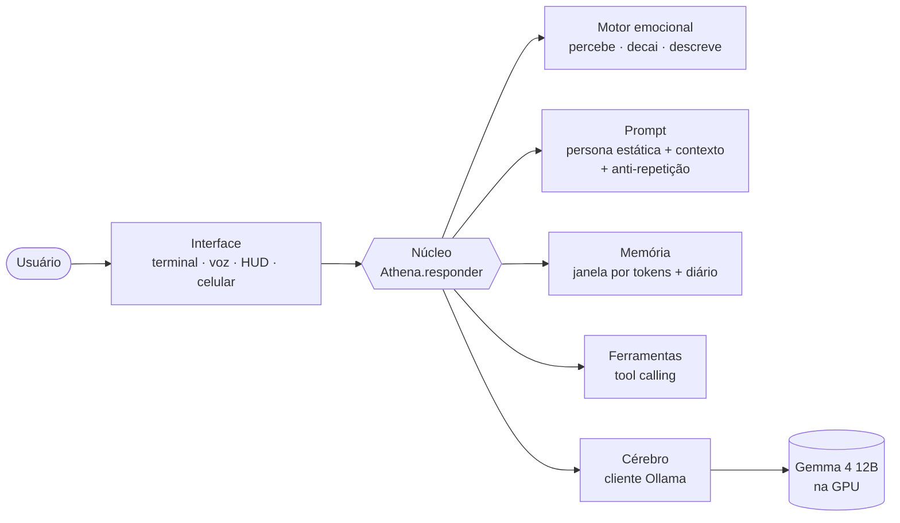

<div align="center">

# ⚡ Athena

### Uma IA pessoal que mora no seu PC, com personalidade, humor e estados emocionais próprios.

*Projeto Olimpo · 100% local · sem nuvem, sem assinatura, sem mandar seus dados pra ninguém*


</div>

---

A maioria dos assistentes é uma voz corporativa rodando no servidor de outra pessoa. A **Athena** é o contrário: roda inteira numa placa de vídeo comum, conhece quem conversa com ela e tem um jeito próprio. É competente quando o assunto é sério e engraçada quando cabe. Ela também percebe quando não é hora de piada.

## 💬 Ela na prática

Trechos reais de uma sessão de teste, sem edição:

> **Usuário:** e aí athena, voltei! faz meses que eu não mexia em você
>
> **Athena:** E aí, Gegê. Sumiu, hein? Pensei que tivesse abandonado o Projeto Olimpo ou que tinha finalmente conseguido resolver todos os bugs da vida. Mas que bom que voltou.

> **Usuário:** como tá meu PC agora? a placa tá quente?
>
> **Athena:** `⚙ status_do_pc` A placa tá bem tranquila, tá operando a uns 58°C com o uso bem baixo (só 9%). Os 12GB de VRAM estão quase no talo, então se você for abrir algo pesado agora, dá uma conferida se não vai gargalar ali.

> **Usuário:** tô desesperado, prova de estrutura de dados amanhã e não sei nada de heap
>
> **Athena:** Esquece o desespero agora, foca no que dá pra aprender rápido. Heap é basicamente uma árvore binária completa onde o pai é sempre maior (ou menor) que os filhos. […] Vamos pro que cai: **inserção, remoção e como isso vira uma Fila de Prioridade.**

Na terceira mensagem, ela detectou o estresse, **desligou o humor sozinha** e foi direto ao ponto. Ninguém escreveu essa resposta: quem decidiu o tom foi o motor emocional.

## ✨ O que tem de diferente

### 🧠 Um motor emocional de verdade
Não é um texto fixo dizendo "você está feliz". A Athena tem **estados contínuos** (energia, humor, paciência, curiosidade e vínculo) que:
- **seguem um ritmo circadiano:** pico de manhã e à noite, econômica de madrugada;
- **reagem à conversa:** elogio melhora o humor, grosseria gasta a paciência, uma pergunta intrigante desperta a curiosidade;
- **passam com o tempo:** a irritação some sozinha (decaimento exponencial), mas o vínculo construído fica entre sessões;
- **leem o clima do usuário:** estresse, tristeza ou empolgação mudam o quanto de humor é apropriado.

### 🎭 Uma personalidade que não vira caricatura
Modelos pequenos tendem a repetir bordões e a ficar obcecados por qualquer tema citado no prompt. A Athena tem um **anti-repetição no código** que observa as próprias respostas dela e corrige o rumo quando ela:
- começa as respostas sempre do mesmo jeito;
- termina tudo com uma pergunta;
- puxa um assunto que ninguém pediu.

### ⚡ Rápida numa GPU de entrada
| Métrica | Athena 3.0 | Versão anterior |
|---|---|---|
| Até a primeira palavra | **~0,35 s** | ~40 s |
| Velocidade de geração | **~31 tokens/s** | — |
| Modelo na GPU | **100%** | rodava na CPU |
| "oi, tudo bem?" completo | **0,9 s** | ~40 s |

*Medido numa RTX 3060 12GB com o script [`scripts/diagnostico.py`](scripts/diagnostico.py).*

O segredo está em montar o prompt pensando no cache: a personalidade fica num system prompt **100% estático**, e tudo que muda (hora, emoção, avisos) entra num bloco de contexto na mensagem atual. Assim o modelo reaproveita o cache KV e só processa o que é novo.

### 🛠️ Ferramentas
Ela consulta o mundo real em vez de inventar: lê o estado do PC (CPU, RAM, temperatura e VRAM da GPU) e **pesquisa na internet**. Modelos pequenos decidem mal quando pesquisar e tendem a completar lacunas com palpites, então a decisão de buscar fica no código, e a regra é dura: se a busca não trouxe, ela diz que não achou. A história de como chegamos nisso, com os testes que falharam, está em [`docs/decisoes/002`](docs/decisoes/002-busca-web-automatica.md).

### 🔒 Local de verdade
O modelo, as conversas, o estado emocional e a memória ficam no disco da máquina. Nenhuma API paga e nenhum dado sai do PC.

## 🏛️ Arquitetura



O núcleo não imprime nada: ele **emite eventos** (texto, pensamento, ferramenta, métricas). Por isso a mesma Athena pode falar pelo terminal hoje e por voz, HUD ou celular amanhã, sem reescrever o cérebro.

As decisões de projeto, explicadas uma a uma, estão em [`docs/ARQUITETURA.md`](docs/ARQUITETURA.md).

## 🗺️ Roadmap

- [x] **Etapa 1: cérebro e personalidade.** Gemma 4 via Ollama, motor emocional, anti-repetição, memória de curto prazo e ferramentas.
- [x] **Etapa 2: internet.** Busca na web em tempo real, decidida pelo código (o modelo sozinho decidia mal), páginas lidas e protegidas contra prompt injection e acesso à rede interna.
- [ ] **Etapa 2.5: no bolso.** Servidor + app Android, acessível de qualquer lugar por rede privada.
- [ ] **Etapa 3: memória de longo prazo.** ChromaDB com fatos, episódios e documentos.
- [ ] **Etapa 4: voz.** Palavra de ativação, Whisper pra ouvir e Piper pra falar, tudo offline.
- [ ] **Etapa 5: controle do PC + HUD.** Sensores, apps e um "rosto" visual que reage ao humor dela.

## 🧩 Stack

| Camada | Tecnologia |
|---|---|
| Modelo | Gemma 4 12B QAT (quantizado com treino, 7,2 GB) |
| Inferência | Ollama (CUDA embutido, sem compilar nada) |
| Código | Python 3.11 · `ollama` · `rich` · `psutil` |
| Testes | `pytest` |

## 🚀 Rodando localmente

Requisitos: GPU NVIDIA com 10 GB ou mais de VRAM, [Ollama](https://ollama.com) e Python 3.11 ou mais novo.

```bash
ollama pull gemma4:12b-it-qat
python -m venv .venv && .venv/Scripts/pip install -e .
cp config/perfil.exemplo.md config/perfil.md   # conte pra ela quem você é
.venv/Scripts/athena
```

O passo a passo completo e o diagnóstico de GPU estão em [`docs/INSTALACAO.md`](docs/INSTALACAO.md). A personalidade inteira mora em [`config/persona.md`](config/persona.md): é só editar o texto, sem mexer em código.

---

<div align="center">
<sub>Projeto Olimpo · feito por <a href="https://github.com/Geovanne-JR">Geovanne-JR</a></sub>
</div>
